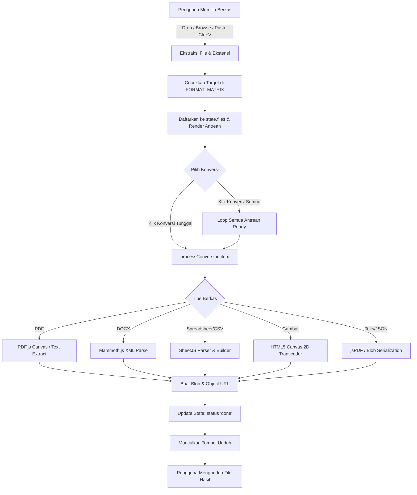

# ConvertSphere &bull; Minimalist & Fast Client-Side File Converter

ConvertSphere adalah aplikasi web konverter file berbasis **100% Client-Side** yang cepat, ringan, dan mengutamakan privasi. Seluruh proses konversi dokumen, spreadsheet, data, dan gambar berlangsung langsung di peramban (browser) pengguna tanpa ada pengunggahan berkas ke server pihak ketiga (*Zero Server Footprint*).

---

## 📑 Daftar Isi
1. [Fitur Utama](#-fitur-utama)
2. [Format yang Didukung](#-format-yang-didukung)
3. [Arsitektur & Pustaka (Libraries)](#-arsitektur--pustaka-libraries)
4. [Struktur Berkas Proyek](#-struktur-berkas-proyek)
5. [Alur Kerja Sistem (Workflow)](#-alur-kerja-sistem-workflow)
6. [Panduan Penggunaan](#-panduan-penggunaan)
7. [Penjelasan Kode Sumber](#-penjelasan-kode-sumber)
8. [Keamanan & Privasi](#-keamanan--privasi)

---

## 🌟 Fitur Utama

- **100% Client-Side Processing**: Berkas tidak pernah dikirim ke backend/cloud. Semua data diproses menggunakan memori browser lokal.
- **Dukungan Berbagai Format Populer**: Meliputi dokumen PDF, Microsoft Word (DOCX), Spreadsheet (Excel & CSV), Gambar (PNG, JPG, WEBP), serta format teks/data (JSON, TXT, MD, HTML).
- **Beragam Metode Masukan (Input)**:
  - Tombol telusur berkas (*File Explorer*).
  - *Drag and Drop* interaktif ke area dropzone.
  - Tempel langsung dari papan klip (*Clipboard Paste* via `Ctrl + V`).
- **Antrean File & Konversi Massal (*Batch Conversion*)**:
  - Konversi satu per satu atau sekaligus (*Convert All*).
  - Indikator progres per berkas secara riil.
  - Pembersihan antrean dengan satu klik (*Clear All*).
- **Desain Modern & Responsif**:
  - Gaya visual clean dan minimalis dengan font Google *Plus Jakarta Sans*.
  - Dukungan tema **Dark Mode** dan **Light Mode** otomatis yang tersimpan di `localStorage`.
  - Notifikasi Toast informatif atas setiap aksi pengguna.

---

## 🔄 Format yang Didukung

Aplikasi memetakan format berkas secara dinamis melalui matriks target:

| Kategori | Format Asal (Input) | Format Tujuan yang Didukung (Output) |
| :--- | :--- | :--- |
| **PDF** | `.pdf` | JPG, PNG, DOCX, TXT, HTML |
| **Word** | `.docx`, `.doc` | PDF, TXT, HTML, CSV |
| **Spreadsheet & Data** | `.csv` | XLSX, JSON, PDF, HTML, TXT |
| | `.xlsx` | CSV, JSON, PDF, HTML, TXT |
| | `.json` | XLSX, CSV, PDF, TXT |
| **Gambar** | `.png`, `.jpg`, `.jpeg`, `.webp`, `.svg`, `.bmp` | PNG, JPG, WEBP, PDF |
| **Teks & Markdown** | `.txt`, `.md`, `.html` | PDF, DOCX, HTML, TXT, Base64 |

---

## 🛠️ Arsitektur & Pustaka (Libraries)

Aplikasi dibangun murni menggunakan **HTML5**, **Vanilla CSS**, dan **Vanilla JavaScript (ES6+)**, didukung oleh beberapa engine pemrosesan klien via CDN:

1. **[PDF.js](https://mozilla.github.io/pdf.js/) (`v3.11.174`)**
   - Digunakan untuk merender halaman PDF ke elemen `<canvas>` beresolusi tinggi (2x crisp scale) saat mengekspor ke JPG/PNG.
   - Digunakan untuk ekstraksi stream teks murni (*text stream extraction*) dari setiap halaman PDF.
2. **[jsPDF](https://github.com/parallax/jsPDF) (`v2.5.1`)**
   - Digunakan untuk kompilasi dan pembuatan berkas biner `.pdf` baru dari teks mentah, tabel data, maupun embedding citra beresolusi penuh.
3. **[Mammoth.js](https://github.com/mwilliamson/mammoth.js) (`v1.6.0`)**
   - Berfungsi untuk membaca struktur XML dokumen Microsoft Word `.docx` dan mengekstraknya menjadi HTML semantik atau teks mentah tanpa membutuhkan Microsoft Office.
4. **[SheetJS / xlsx](https://sheetjs.com/) (`v0.18.5`)**
   - Berfungsi untuk membaca dan menghasilkan buku kerja biner Microsoft Excel (`.xlsx`), tabel CSV, serta konversi timbal balik dengan objek JSON.
5. **HTML5 Canvas 2D Context API**
   - Digunakan untuk *transcoding* gambar antar-format secara natif (misalnya PNG ke WEBP/JPG dengan penanganan latar belakang transparansi ke putih).

---

## 📁 Struktur Berkas Proyek

```text
file-converter/
├── index.html       # Struktur markup, header, hero, dropzone, antrean, & integrasi library
├── style.css        # Variabel warna CSS (Dark/Light), tata letak, komponen UI, & animasi
├── app.js           # Logika aplikasi, state management, event listeners, & conversion engines
└── README.md        # Dokumentasi teknis proyek
```

---

## 🚀 Alur Kerja Sistem (Workflow)



---

## 📖 Panduan Penggunaan

### 1. Menjalankan Aplikasi
Karena aplikasi ini 100% *client-side*, Anda dapat menjalankannya dengan:
- **Cara Langsung**: Klik dua kali berkas `index.html` untuk langsung membukanya di browser modern (Chrome, Edge, Firefox, Safari).
- **Menggunakan Local Server (Disarankan)**:
  - Menggunakan ekstensi VS Code **Live Server**, atau
  - Menjalankan perintah terminal lokal: `npx serve .` atau `python -m http.server 8000`.

### 2. Memasukkan Berkas
- **Klik Area Dropzone**: Buka jendela dialog pemilihan file untuk memilih satu atau banyak berkas.
- **Tarik & Lepas (*Drag and Drop*)**: Seret berkas dari penjelajah file komputer langsung ke area bergaris putus-putus.
- **Clipboard (*Ctrl + V*)**: Salin berkas atau potongan gambar dari mana saja, lalu tekan `Ctrl + V` di halaman aplikasi.

### 3. Mengatur Format Target
- Setiap berkas yang masuk akan otomatis diberikan format tujuan yang paling umum.
- Anda dapat mengubah format luaran melalui menu tarik-turun (*dropdown*) di samping nama berkas.

### 4. Menjalankan Konversi
- Klik tombol **Konversi** pada masing-masing baris, atau klik **Konversi Semua** di bagian atas antrean.
- Baris progres akan bergerak menandakan proses konversi sedang berjalan.

### 5. Mengunduh Hasil
- Setelah status berubah menjadi **Selesai**, klik tombol **Unduh**. Berkas hasil konversi akan tersimpan ke folder *Downloads* Anda.

---

## 💻 Penjelasan Kode Sumber

### 1. Manajemen State (`app.js`)
State aplikasi disimpan dalam objek global sederhana:
```javascript
const state = {
  files: [],   // Daftar berkas dalam antrean beserta status dan blob hasil
  theme: localStorage.getItem('cs_theme') || 'dark', // Pilihan tema pengguna
};
```

Setiap elemen antrean memuat properti:
- `id`: Pengenal unik acak berkas.
- `file`: Objek `File` biner asli dari browser.
- `name`, `size`, `ext`, `category`: Metadata berkas.
- `targetFormat`: Format luaran yang dipilih.
- `availableTargets`: Daftar opsi konversi yang valid untuk format tersebut.
- `status`: `'ready' | 'converting' | 'done' | 'error'`.
- `progress`: Nilai numerik 0-100%.
- `convertedBlob`: Objek `Blob` hasil olahan mesin konversi.
- `convertedUrl`: URL memori sementara yang dibuat via `URL.createObjectURL()`.

### 2. Mesin Konversi Utama (`processConversion`)
Fungsi `processConversion(item)` bertindak sebagai router logis yang memetakan jenis file masukan dan format target ke fungsi pemroses spesifik:
- **`convertPdfToImageReal(file, targetFormat)`**: Memanfaatkan PDF.js untuk memuat dokumen, membuka halaman pertama, menggambarnya pada kanvas HTML5, lalu mengekspornya menjadi Blob gambar `image/jpeg` atau `image/png`.
- **`extractTextFromPdfReal(file)`**: Membaca seluruh halaman PDF, mengambil token teks (`textContent.items`), dan menggabungkannya menjadi dokumen teks terstruktur.
- **`convertDocxReal(file, targetFormat)`**: Menggunakan Mammoth.js untuk mengekstrak teks asli atau elemen HTML dari arsip ZIP berkas `.docx`.
- **`convertCsvToXlsxReal(file)`** & **`convertXlsxReal(file, targetFormat)`**: Memanfaatkan SheetJS untuk membaca lembar kerja (*worksheet*), membuat struktur buku kerja (*workbook*), dan mengonversinya ke format spreadsheet atau data lain.
- **`convertImageFormatReal(file, targetFormat)`**: Memanfaatkan objek `Image()` dan Canvas untuk mengubah format citra bitmap.
- **`createPdfFromTextReal(title, text)`**: Memanfaatkan `jsPDF` untuk memecah teks menjadi baris-baris berhalaman A4 dengan margin yang rapi.

### 3. Sistem Tema Dinamis (`style.css`)
Desain responsif diatur menggunakan variabel CSS (*custom properties*):
```css
:root {
  --bg-primary: #0a0c10;
  --bg-surface: #12161f;
  --text-main: #f3f4f6;
  --accent: #3b82f6;
  /* ... */
}

[data-theme="light"] {
  --bg-primary: #f8fafc;
  --bg-surface: #ffffff;
  --text-main: #0f172a;
  /* ... */
}
```
Pergantian tema dikelola oleh fungsi `toggleTheme()` yang secara langsung memanipulasi atribut `data-theme` pada tag `<html>`.

---

## 🔒 Keamanan & Privasi

1. **Tanpa Pengiriman Jaringan (*No Network Telemetry*)**:
   Berkas pengguna tidak pernah diunggah ke server manapun. Anda dapat memverifikasinya melalui tab *Network* di DevTools peramban—tidak ada permintaan `POST` berkas yang keluar.
2. **Pembersihan Memori (*Memory Management*)**:
   Ketika antrean dibersihkan atau item dihapus, URL objek memori dilepaskan kembali menggunakan `URL.revokeObjectURL()` untuk mencegah kebocoran memori (*memory leak*).
3. **Dukungan Offline**:
   Jika pustaka eksternal (CDN) telah tersimpan di *cache* peramban atau diunduh secara lokal, aplikasi dapat berfungsi penuh tanpa koneksi internet aktif.

---
&copy; 2026 ConvertSphere. Dibuat dengan performa tinggi & pendekatan minimalis.
